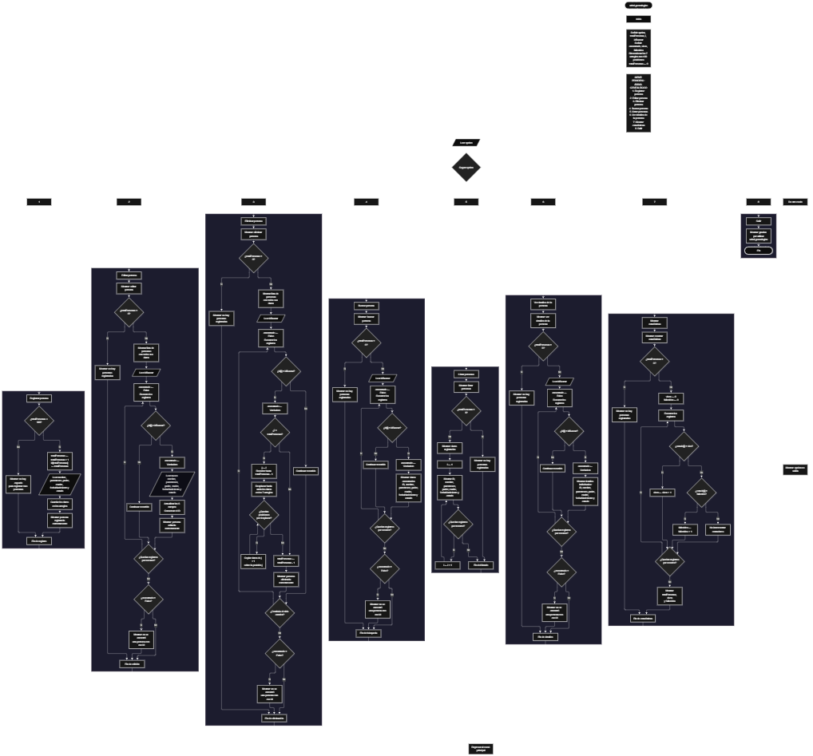

 

Este proyecto, llamado <b>árbol genealógico</b>, fue desarrollado en <b>pseint</b> como un ejercicio práctico para fortalecer la lógica de programación mediante la creación de un sistema de gestión de personas relacionadas con una familia desde la consola. El programa cuenta con un menú principal de ocho opciones que permite <b>registrar, editar, eliminar, buscar, listar y consultar los detalles de las personas registradas, además de mostrar estadísticas generales</b>. Cada persona almacena información como el nombre, el parentesco, el nombre del padre, el nombre de la madre, la fecha de nacimiento y el estado, utilizando arreglos con una capacidad máxima de <b>100 personas durante la ejecución</b>. Durante su desarrollo se aplicaron conceptos fundamentales de programación, como variables, arreglos, estructuras condicionales, ciclos repetitivos y estructuras de selección, además de procesos para buscar, modificar, eliminar y organizar registros. Las estadísticas permiten conocer la cantidad total de personas registradas, cuántas están vivas y cuántas han fallecido. Este proyecto permite poner en práctica los conocimientos adquiridos en pseint y sirve como base para desarrollar sistemas de gestión familiar más avanzados utilizando otros lenguajes y tecnologías.

<h2 align="center">⚙️ Funcionamiento del menú principal</h2>

### ➕ Registrar persona

La opción <b>1) registrar persona</b> permite incorporar una nueva persona al sistema. Antes de realizar el registro, el programa comprueba que la cantidad de personas almacenadas sea menor a <b>100</b>, utilizando la condición <b>totalpersonas &lt; 100</b>. Si existe espacio disponible, la variable <b>totalpersonas</b> aumenta en uno y el programa asigna un identificador mediante la instrucción <b>id[totalpersonas] &lt;- totalpersonas</b>. A continuación, solicita el <b>nombre, parentesco, nombre del padre, nombre de la madre, fecha de nacimiento y estado</b> de la persona. Los datos se almacenan en las posiciones correspondientes de sus respectivos arreglos. Finalmente, muestra el mensaje <b>"persona registrada correctamente."</b>. Si se alcanza la capacidad máxima, presenta el mensaje <b>"no hay espacio para registrar mas personas."</b>, impidiendo incorporar otro registro mientras el contador permanezca en 100.

### ✏️ Editar persona

La opción <b>2) editar persona</b> permite modificar la información de una persona registrada. Primero, el programa comprueba si existen registros mediante la variable <b>totalpersonas</b>. Si no hay personas almacenadas, muestra el mensaje <b>"no hay personas registradas."</b>. En caso contrario, presenta una lista con el id, nombre, parentesco, padre, madre, fecha de nacimiento y estado de cada persona. Después, solicita el id de la persona que se desea editar y utiliza la variable lógica <b>encontrado</b>, inicializada con el valor <b>falso</b>, para determinar si existe una coincidencia. Mediante un ciclo <b>para</b>, recorre los identificadores almacenados y compara cada uno con el valor introducido. Si encuentra la persona, cambia <b>encontrado</b> a <b>verdadero</b> y solicita el nuevo nombre, parentesco, padre, madre, fecha de nacimiento y estado, actualizando directamente los arreglos correspondientes. El id se conserva sin modificaciones. Finalmente, muestra el mensaje <b>"persona editada correctamente."</b>. Si no encuentra el identificador solicitado, presenta el mensaje <b>"no se encontró una persona con ese id."</b>.

### 🗑️ Eliminar persona

La opción <b>3) eliminar persona</b> permite eliminar una persona registrada mediante su id. Primero, el programa comprueba si existen personas almacenadas. Si no hay registros, muestra el mensaje <b>"no hay personas registradas."</b>. Si existen personas, presenta una lista con sus identificadores y datos para facilitar la selección. Después, solicita el id de la persona que se desea eliminar e inicializa la variable <b>encontrado</b> con el valor <b>falso</b>. A continuación, recorre los registros mediante un ciclo <b>para</b> y compara los identificadores. Cuando encuentra una coincidencia, cambia la variable a <b>verdadero</b>. Si la persona no ocupa la última posición, utiliza otro ciclo <b>para</b>, controlado por la variable <b>j</b>, para desplazar una posición hacia atrás los datos de los arreglos <b>id, nombre, parentesco, padre, madre, fechanacimiento y estado</b>. Posteriormente, disminuye <b>totalpersonas</b> en uno y muestra el mensaje <b>"persona eliminada correctamente."</b>. Si no encuentra el id solicitado, presenta el mensaje <b>"no se encontró una persona con ese id."</b>. En el código actual, el ciclo exterior no se interrumpe expresamente después de encontrar una coincidencia y la última posición ocupada no se limpia de manera explícita.

### 🔎 Buscar persona

La opción <b>4) buscar persona</b> permite localizar a una persona mediante su id. Primero, el programa comprueba si existen personas registradas. Si el sistema está vacío, muestra el mensaje <b>"no hay personas registradas."</b>. En caso contrario, solicita el identificador de la persona que se desea buscar e inicializa la variable lógica <b>encontrado</b> con el valor <b>falso</b>. Después, utiliza un ciclo <b>para</b> para recorrer los identificadores almacenados y compararlos con el valor introducido mediante la condición <b>id[i] = idbuscar</b>. Cuando encuentra una coincidencia, cambia la variable <b>encontrado</b> a <b>verdadero</b>, muestra el mensaje <b>"datos encontrados"</b> y presenta el id, nombre, parentesco, padre, madre, fecha de nacimiento y estado de la persona. Si finaliza el recorrido sin encontrar coincidencias, muestra el mensaje <b>"no se encontró una persona con ese id."</b>. La búsqueda se realiza mediante el identificador y no mediante el nombre de la persona.

### 📋 Listar personas

La opción <b>5) listar personas</b> permite visualizar todas las personas registradas actualmente en el sistema. Antes de mostrar la información, el programa comprueba si la variable <b>totalpersonas</b> es igual a cero. Si no existen registros, presenta el mensaje <b>"no hay personas registradas."</b>. Si hay personas disponibles, muestra el encabezado <b>"datos registrados"</b> y utiliza un ciclo <b>para</b> para recorrer los arreglos desde la primera posición hasta el total actual de personas. Durante el recorrido, presenta el id, nombre, parentesco, padre, madre, fecha de nacimiento y estado de cada registro. Esta función facilita consultar la información general de todas las personas sin necesidad de buscarlas individualmente.

### 📄 Ver detalles de la persona

La opción <b>6) ver detalles de la persona</b> permite consultar individualmente todos los datos de una persona específica. Primero, el programa comprueba si existen personas registradas. Si no hay registros, muestra el mensaje <b>"no hay personas registradas."</b>. En caso contrario, solicita el id de la persona que se desea consultar e inicializa la variable <b>encontrado</b> con el valor <b>falso</b>. Después, recorre los identificadores mediante un ciclo <b>para</b>. Cuando encuentra una coincidencia, cambia la variable a <b>verdadero</b> y muestra el encabezado <b>"detalles de la persona"</b>. A continuación, presenta individualmente el id, nombre, parentesco, padre, madre, fecha de nacimiento y estado. Si no encuentra el identificador solicitado, presenta el mensaje <b>"no se encontró una persona con ese id."</b>. Esta opción permite consultar la información de una persona de manera más detallada que el listado general.

### 📊 Mostrar estadísticas

La opción <b>7) mostrar estadísticas</b> permite obtener un resumen de las personas registradas según su estado. Primero, el programa comprueba si existen registros. Si no hay personas almacenadas, muestra el mensaje <b>"no hay personas registradas."</b>. En caso contrario, inicializa las variables <b>vivos</b> y <b>fallecidos</b> en cero y recorre los registros mediante un ciclo <b>para</b>. En cada repetición, comprueba el valor almacenado en el arreglo <b>estado</b>. Si el estado es exactamente <b>"vivo"</b>, incrementa la variable <b>vivos</b> en uno. De lo contrario, comprueba si el estado es exactamente <b>"fallecido"</b> y, si coincide, incrementa la variable <b>fallecidos</b>. Al finalizar el recorrido, presenta el encabezado <b>"estadistica general"</b> y muestra el total de personas registradas, la cantidad de personas vivas y la cantidad de personas fallecidas. Los registros con estados diferentes de esos dos valores no se incluyen en ninguno de los conteos.

### 🚪 Salir del menú principal

La opción <b>8) salir</b> permite finalizar la ejecución del programa y muestra el mensaje <b>"gracias por utilizar arbol genealogico."</b>. El menú principal se encuentra dentro de una estructura repetitiva <b>repetir ... hasta que</b>, que mantiene el programa en funcionamiento mientras el usuario realiza las operaciones disponibles. En el código actual, la condición de salida es <b>hasta que opcion = 8</b>, por lo que coincide correctamente con el número asignado a la opción de salida. Después de seleccionar esta opción, el ciclo termina y el algoritmo finaliza.

<h2 align="center">🧠 Temas aplicados en el proyecto</h2>

### 📦 Variables

En este proyecto se utilizan variables para controlar la opción seleccionada en el menú, almacenar la cantidad de personas registradas, recorrer los arreglos, guardar el identificador que se desea buscar y determinar si una persona fue encontrada. También se emplean variables para calcular las estadísticas de personas vivas y fallecidas. Cada variable cumple una función específica dentro de las operaciones del sistema y permite organizar el funcionamiento del programa.

🔢 **Opcion:** Almacena la opción seleccionada por el usuario en el menú principal.

📊 **TotalPersonas:** Almacena la cantidad actual de personas registradas.

🔄 **I:** Funciona como contador para recorrer los registros almacenados en los arreglos.

🔁 **J:** Controla el recorrido utilizado para desplazar los datos durante la eliminación de una persona.

🔎 **IdBuscar:** Almacena el identificador introducido por el usuario para buscar, editar, eliminar o consultar una persona.

✅ **Encontrado:** Variable lógica que indica si se ha localizado una persona con el id solicitado.

👨 **Vivos:** Cuenta las personas cuyo estado es exactamente `"vivo"`.

🕊️ **Fallecidos:** Cuenta las personas cuyo estado es exactamente `"fallecido"`.

### 🗃️ Arreglos

En este proyecto se utilizan siete arreglos relacionados entre sí para almacenar los datos de cada persona. Cada arreglo tiene una capacidad de <b>100 posiciones</b> y utiliza el mismo índice para representar la información correspondiente a un mismo registro. Por ejemplo, los datos de la persona almacenada en la posición <b>1</b> se encuentran distribuidos entre <b>id[1], nombre[1], parentesco[1], padre[1], madre[1], fechanacimiento[1] y estado[1]</b>. Esta organización permite recorrer, buscar, modificar, mostrar y eliminar personas manteniendo sus datos asociados a una misma posición.

🆔 **Id[100]:** Almacena los identificadores asignados a las personas registradas.

📝 **Nombre[100]:** Almacena los nombres de las personas.

👨‍👩‍👧 **Parentesco[100]:** Almacena el parentesco indicado para cada persona.

👨 **Padre[100]:** Almacena el nombre del padre de cada persona.

👩 **Madre[100]:** Almacena el nombre de la madre de cada persona.

📅 **FechaNacimiento[100]:** Almacena las fechas de nacimiento introducidas por el usuario.

📌 **Estado[100]:** Almacena el estado indicado para cada persona, como `"vivo"` o `"fallecido"`.

### 🔀 Estructuras condicionales

En este proyecto se utilizan las estructuras <b>si</b> y <b>sino</b> para comprobar si existe espacio disponible antes de registrar una persona, verificar si hay registros antes de ejecutar determinadas operaciones, comprobar si el id introducido coincide con uno almacenado y determinar si se debe desplazar la información durante una eliminación. También se utilizan para clasificar las personas según su estado en el cálculo de estadísticas. Estas condiciones permiten que el programa ejecute diferentes instrucciones según la información disponible y el resultado de cada comprobación.

### 🔄 Estructuras repetitivas

En este proyecto se utilizan los ciclos <b>para</b> y <b>repetir ... hasta que</b>. Los ciclos <b>para</b> permiten recorrer los arreglos para mostrar las personas, buscar identificadores, editar datos y calcular estadísticas. Durante la eliminación, también se utilizan para desplazar los registros posteriores una posición hacia atrás. Por otro lado, el ciclo <b>repetir ... hasta que</b> mantiene activo el menú principal y permite ejecutar diferentes operaciones hasta que el usuario selecciona la opción <b>8</b>, que corresponde a salir del programa.

### 🎯 Estructura según

El programa utiliza la estructura <b>segun</b> para evaluar el valor almacenado en la variable <b>opcion</b> y ejecutar el bloque de instrucciones correspondiente. Cada caso representa una operación específica del sistema: <b>registrar, editar, eliminar, buscar, listar, ver detalles, mostrar estadísticas o salir</b>. También se utiliza el bloque <b>de otro modo</b> para mostrar el mensaje <b>"opcion no valida."</b> cuando el valor introducido no coincide con ninguna de las ocho opciones definidas en el menú.

### 🔢 Dimensionamiento de arreglos

El programa utiliza la instrucción <b>dimension</b> para establecer la capacidad de los siete arreglos que almacenan la información de las personas. Cada arreglo dispone de <b>100 posiciones</b>, lo que permite registrar hasta 100 personas mientras se mantenga el contador dentro de su límite. La variable <b>totalpersonas</b> controla la cantidad de registros activos y se incrementa durante el registro y disminuye durante la eliminación. Las operaciones recorren las posiciones comprendidas entre la primera y la última persona registrada según el valor actual de este contador.

### 🔄 Reorganización de registros

Cuando se elimina una persona, el programa comprueba si su posición es anterior a la última posición ocupada. Si es así, utiliza un ciclo <b>para</b> controlado por la variable <b>j</b> para copiar los datos de la posición siguiente sobre la posición actual en los siete arreglos: <b>id, nombre, parentesco, padre, madre, fechanacimiento y estado</b>. Posteriormente, disminuye <b>totalpersonas</b> en uno. Este procedimiento busca mantener los registros activos agrupados en las primeras posiciones de los arreglos. Sin embargo, el código no limpia expresamente la última posición después del desplazamiento y continúa ejecutando el ciclo exterior después de la coincidencia, por lo que el comportamiento de la eliminación depende de la lógica implementada en el algoritmo.

<h2 align="center">¿Cómo se implementaron las operaciones crud en el proyecto?</h2>

Las operaciones <b>crud</b> se implementaron mediante las opciones del menú principal para administrar la información de las personas registradas. La operación <b>crear</b> corresponde a <b>registrar persona</b>, donde se solicitan los datos y se almacenan en los arreglos. La operación <b>leer</b> se realiza mediante las opciones <b>buscar persona, listar personas y ver detalles de la persona</b>, que permiten consultar los registros por id, mostrar todas las personas o presentar los datos individuales de una persona. La operación <b>actualizar</b> corresponde a <b>editar persona</b>, donde se modifican los datos de un registro existente sin cambiar su identificador. Finalmente, la operación <b>eliminar</b> corresponde a <b>eliminar persona</b>, que desplaza los datos posteriores cuando corresponde y disminuye el contador de registros activos. Estas operaciones utilizan variables, arreglos, condicionales y ciclos para gestionar temporalmente la información durante la ejecución del programa.

<h2 align="center">Diagrama de flujo del proyecto</h2>

<h2 align="center">🛡️ Validaciones del programa</h2>

### 📭 No existen personas registradas

Esta comprobación se utiliza en las opciones de <b>editar, eliminar, buscar, listar, ver detalles y mostrar estadísticas</b>. El programa comprueba si la variable <b>totalpersonas</b> es igual a <b>0</b> y, cuando no existen registros, muestra el mensaje <b>"no hay personas registradas."</b>. De esta manera, evita continuar con las operaciones que necesitan información almacenada cuando el sistema está vacío.

### ⚠️ Capacidad máxima alcanzada

Esta comprobación se utiliza durante el registro de nuevas personas para controlar la capacidad máxima de los arreglos. El programa evalúa la condición <b>totalpersonas &lt; 100</b> antes de permitir un nuevo registro. Si existe espacio disponible, incrementa el contador y solicita los datos de la persona. Si se alcanza el límite de 100 registros activos, muestra el mensaje <b>"no hay espacio para registrar mas personas."</b> e impide realizar otro registro mientras no haya espacio disponible.

### ❌ Persona no encontrada

Esta comprobación se utiliza durante las operaciones de <b>editar, eliminar, buscar y ver detalles</b>. El programa inicializa la variable lógica <b>encontrado</b> con el valor <b>falso</b> y recorre el arreglo <b>id</b> para comparar los identificadores almacenados con el valor introducido por el usuario. Si encuentra una coincidencia, cambia la variable a <b>verdadero</b> y ejecuta las instrucciones correspondientes a la operación seleccionada. Si termina el recorrido sin encontrar la persona, muestra el mensaje <b>"no se encontró una persona con ese id."</b>. Esta comprobación permite informar al usuario cuando el identificador solicitado no coincide con ningún registro activo.

### 📌 Clasificación por estado

Esta comprobación se utiliza en la opción <b>mostrar estadísticas</b>. El programa recorre el arreglo <b>estado</b> y compara cada valor con las cadenas <b>"vivo"</b> y <b>"fallecido"</b>. Cuando el valor coincide con <b>"vivo"</b>, incrementa la variable <b>vivos</b>; cuando coincide con <b>"fallecido"</b>, incrementa la variable <b>fallecidos</b>. No existe una validación previa que impida introducir otros estados durante el registro o la edición. Por tanto, los valores diferentes de las dos cadenas reconocidas no se contabilizan en ninguna de las categorías mostradas.

### ⚠️ Identificadores y eliminación de personas

El programa asigna el identificador mediante la instrucción <b>id[totalpersonas] &lt;- totalpersonas</b>. Como el contador disminuye al eliminar una persona, un registro posterior puede recibir un identificador que ya se había utilizado anteriormente. Además, el proceso de eliminación no limpia expresamente la última posición ocupada y no interrumpe el ciclo exterior después de encontrar una coincidencia. Estos comportamientos forman parte de la implementación actual y deben tenerse en cuenta al interpretar el funcionamiento de los identificadores y la eliminación de registros.

### ⚠️ Datos familiares y fechas

Durante el registro y la edición, el programa solicita el nombre, parentesco, padre, madre, fecha de nacimiento y estado de cada persona. Sin embargo, no comprueba que los nombres del padre y de la madre correspondan a otras personas registradas, ni establece relaciones automáticas mediante identificadores. Tampoco valida expresamente el formato de la fecha de nacimiento o restringe el estado a las opciones <b>"vivo"</b> y <b>"fallecido"</b>. Por ello, el programa almacena los datos introducidos sin verificar estas condiciones.

### 🔢 Opción inválida

La estructura <b>segun</b> incluye el bloque <b>de otro modo</b>, que muestra el mensaje <b>"opcion no valida."</b> cuando el usuario introduce un valor que no corresponde a las opciones del menú principal. Las opciones válidas están comprendidas entre <b>1</b> y <b>8</b>, y la condición final del ciclo comprueba si <b>opcion = 8</b> para finalizar la ejecución del programa.

### 💾 Almacenamiento temporal

Los datos de las personas se almacenan en arreglos durante la ejecución del programa. El código no implementa archivos, bases de datos ni mecanismos de persistencia para conservar los registros después de finalizar la ejecución. Por esta razón, la información introducida se utiliza mientras el algoritmo permanece en funcionamiento.

<h2 align="center">🎯 Objetivo del proyecto</h2>

El objetivo principal de este proyecto es fortalecer la <b>lógica de programación</b> mediante el desarrollo de un sistema de gestión de personas relacionadas con una familia en <b>pseint</b>. A través de su construcción se busca aplicar los conocimientos adquiridos sobre variables, arreglos, estructuras condicionales, ciclos repetitivos y estructuras de selección, integrándolos para resolver un problema de manera organizada. Además, el proyecto permite comprender cómo registrar, consultar, modificar y eliminar información, así como calcular estadísticas a partir de los datos almacenados. De esta manera, constituye una base para desarrollar aplicaciones de gestión familiar más completas y, posteriormente, implementar relaciones genealógicas más avanzadas utilizando otros lenguajes y tecnologías.

